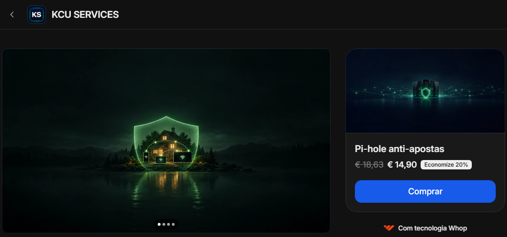
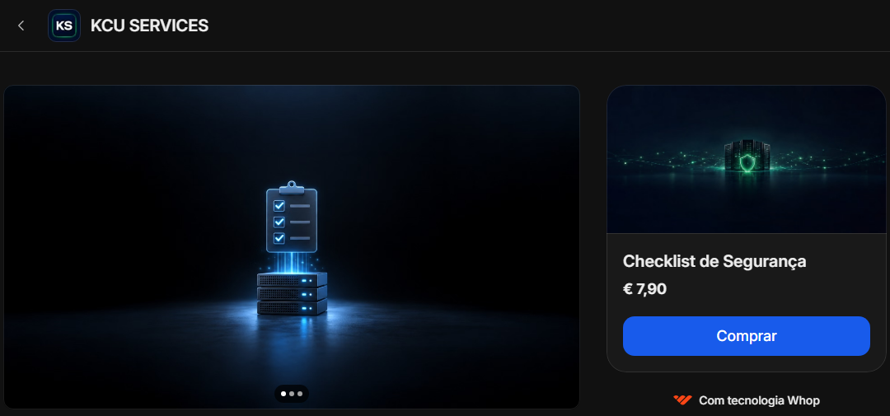
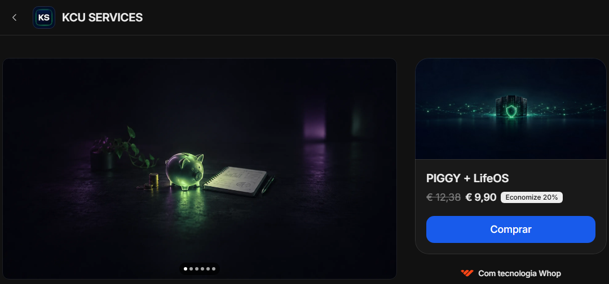
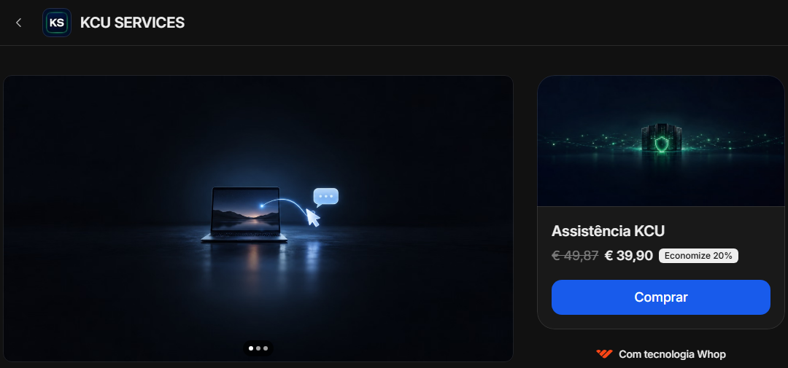

# KCU Services 🛠️

**Segurança, rede e apps que usamos em casa.**

Aqui ficam as ferramentas que construímos para o nosso próprio dia a dia, e a forma como montámos tudo. Fazemos isto à frente de toda a gente, em vídeos sem cortes: vocês dizem o que falta e nós melhoramos.

🌐 **Site:** [kcuservices.github.io](https://kcuservices.github.io)

## Código aberto (de graça para uso pessoal)

| Projeto | O que é |
|---|---|
| [kcu-window](https://github.com/KCUServices/kcu-window) | Abre uma app do teu PC Windows no browser (telemóvel ou outro PC), sem ambiente de trabalho remoto. Mostra só a janela dessa app. |
| [kcu-stack](https://github.com/KCUServices/kcu-stack) | O nosso setup completo: máquinas, Proxmox, IA e as apps que usamos todos os dias, com as definições que funcionam. |
| [kcu-automaticos](https://github.com/KCUServices/kcu-automaticos) | Os scripts que mantêm os nossos PCs Windows a funcionar sozinhos: limpar RAM, desligar à noite, manutenção, vigia de serviços. |
| [kcu-ia-local](https://github.com/KCUServices/kcu-ia-local) | IA a correr em casa: servidor de transcrição compatível com a OpenAI, Qwen em português de Portugal no Ollama e um pipeline imagem → vídeo no ComfyUI. |

Pega, aprende e adapta ao teu. Licença [PolyForm Noncommercial](https://polyformproject.org/licenses/noncommercial/1.0.0): uso pessoal à vontade; para vender ou usar num negócio, fala connosco. O nome KCU, os logótipos e as imagens dos produtos são nossos, com todos os direitos reservados ([marca e imagens](https://github.com/KCUServices/.github/blob/main/MARCA.md)).

## Em destaque

🎬 **[KCU Estúdio](https://github.com/KCUServices/kcu-estudio)**: o nosso estúdio de vídeo com IA, a correr no nosso PC. Filmes longos, shorts, o teu canal e ebooks, da ideia ao vídeo pronto.

## Comunidade

- 💡 **Ideias e melhorias:** [Discussions → Ideas](https://github.com/orgs/KCUServices/discussions/categories/ideas). As que entram ficam no CHANGELOG com o teu nome.
- ❓ **Perguntas:** [Discussions → Q&A](https://github.com/orgs/KCUServices/discussions/categories/q-a)
- 🖥️ **Mostra o teu setup:** [Discussions → Show and tell](https://github.com/orgs/KCUServices/discussions/categories/show-and-tell)
- 🐞 **Algo não funciona:** abre uma *issue* no repositório da ferramenta.

## Produtos

Estes não estão aqui no GitHub. Estão na [loja KCU Services na Whop](https://whop.com/kcu-services/).

### 🛡️ Pi-hole anti-apostas
Fecha a porta às apostas e à pornografia na casa toda.

### 🔒 Playbook de Proteção
Blinda o teu servidor sem expor uma única porta.

### ✅ Checklist de Segurança do Servidor
Os 10 passos, em lista de ação.

### 🐷 PIGGY + LifeOS
As tuas finanças e as tuas notas, sem as entregar a ninguém.

### 🤝 Assistência KCU
Não sabes por onde começar? Começamos contigo.

## Onde estamos

- 🛒 Loja: [whop.com/kcu-services](https://whop.com/kcu-services/)
- 📸 Instagram: [@kcu.services](https://www.instagram.com/kcu.services)
- 🎬 Vídeos sobre isto tudo: [KCUuLAB](https://github.com/KCUuLAB)
