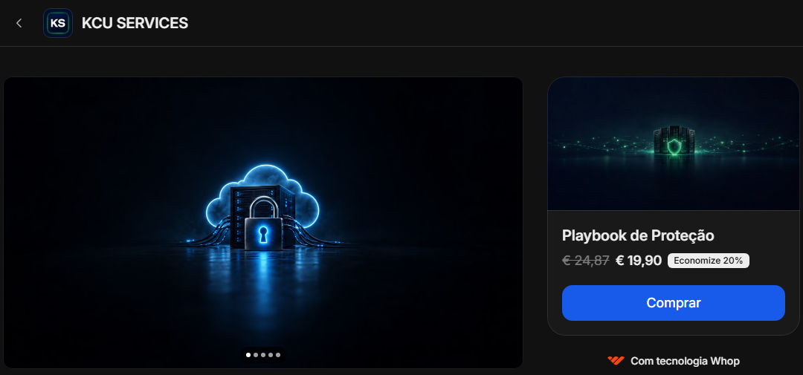

# KCU Services 🛠️

**Segurança, rede e apps que usamos em casa.**

Aqui ficam as ideias que vamos construindo para o nosso próprio dia a dia. O código é aberto e de graça: pega, aprende e adapta ao teu.

## Código aberto (de graça)

| Projeto | O que é |
|---|---|
| [kcu-window](https://github.com/KCUServices/kcu-window) | Abre uma app do teu PC Windows no browser (telemóvel ou outro PC), sem ambiente de trabalho remoto. Mostra só a janela dessa app. É uma ideia de como fizemos o nosso, não um produto com suporte. |

## Produtos

Estes não estão aqui no GitHub. Estão na [loja KCU Services na Whop](https://whop.com/kcu-services/).

### 🛡️ Pi-hole anti-apostas
Fecha a porta às apostas e à pornografia na casa toda.

### 🔒 Playbook de Proteção
Blinda o teu servidor sem expor uma única porta.

### ✅ Checklist de Segurança do Servidor
Os 10 passos, em lista de ação.

### 🐷 PIGGY + LifeOS
As tuas finanças e as tuas notas, sem as entregar a ninguém.

### 🤝 Assistência KCU
Não sabes por onde começar? Começamos contigo.

## Onde estamos

- 🛒 Loja: [whop.com/kcu-services](https://whop.com/kcu-services/)
- 📸 Instagram: [@kcu.services](https://www.instagram.com/kcu.services)
- 🎬 Vídeos sobre isto tudo: [KCUuLAB](https://github.com/KCUuLAB)
